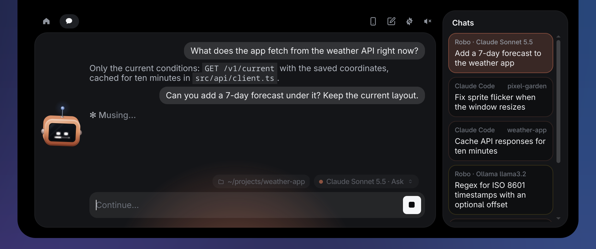
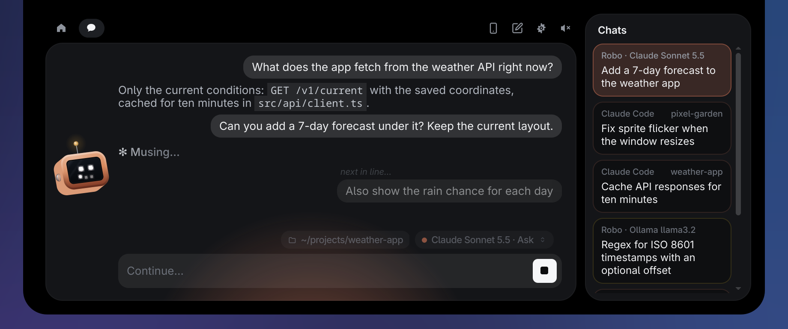
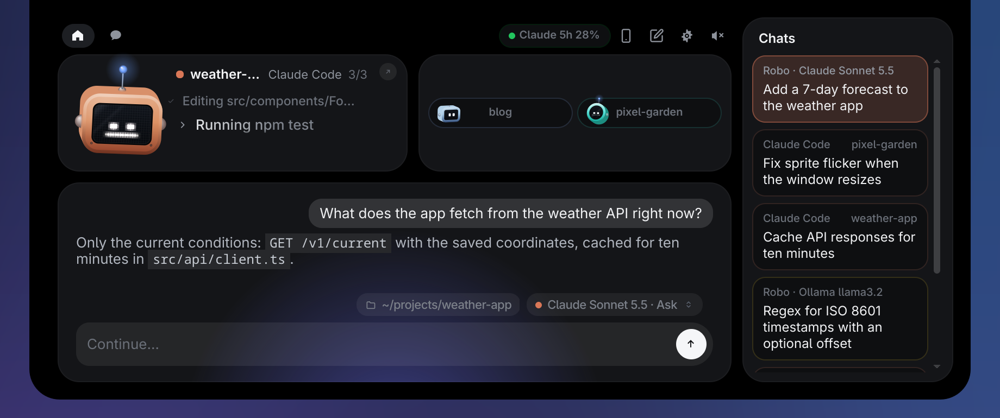
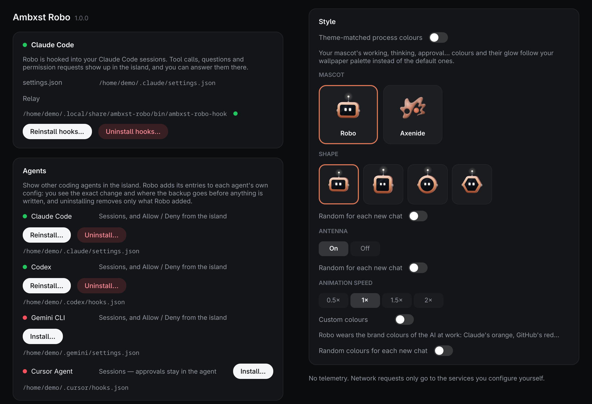
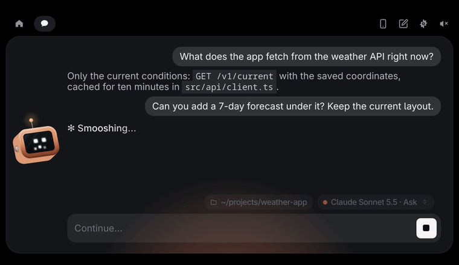
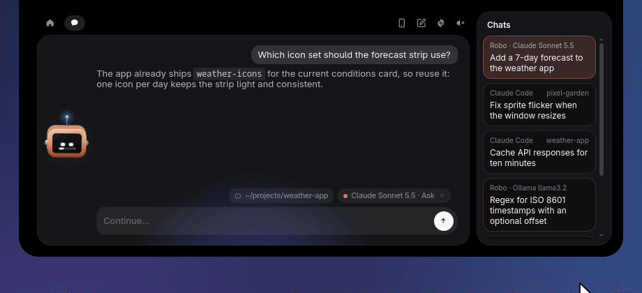
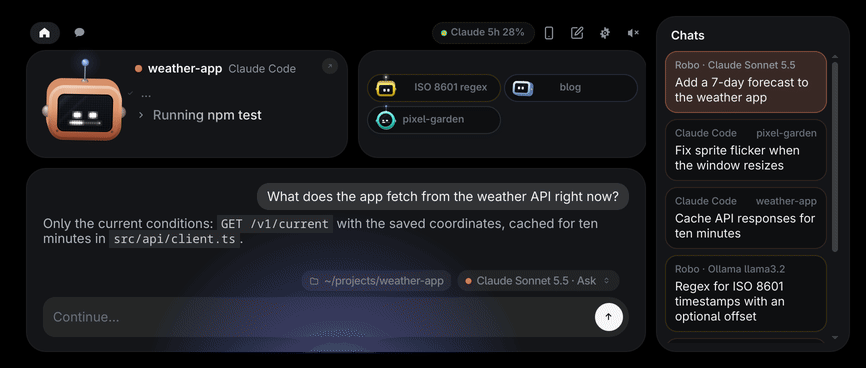
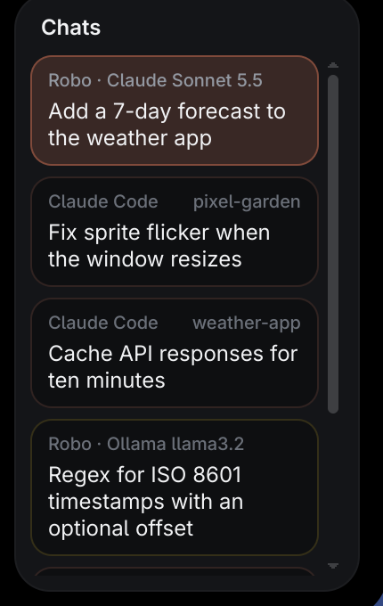
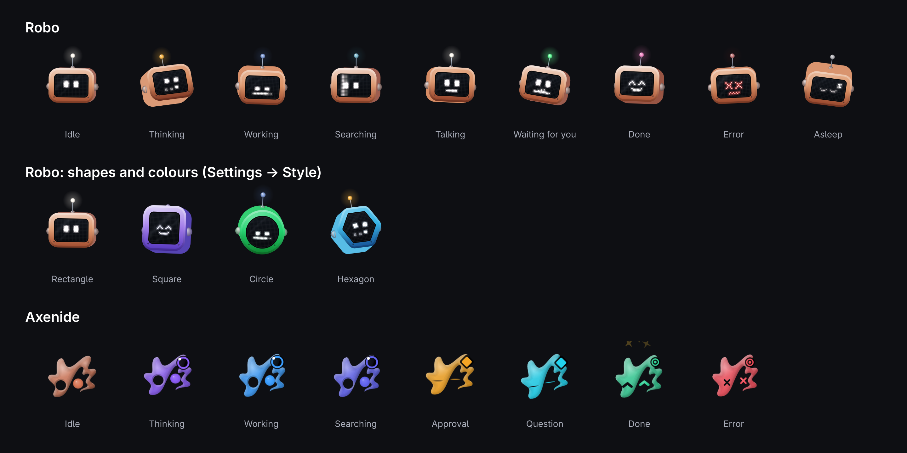

# Ambxst Robo


Version 1.1.0 — see the [changelog](CHANGELOG.md).

Ambxst Robo puts a small robot in [Ambxst](https://github.com/Axenide/Ambxst)'s
notch. It keeps an eye on your AI coding agents (Claude Code, Codex, Gemini
CLI, Cursor Agent, GitHub Copilot CLI and others) and lets you deal with them
without leaving what you are doing:

- approve or deny permission requests and answer agents' questions from the notch;
- see what each session is doing, when it finished, and a recap of your day;
- chat with Claude (the Claude Code CLI, the API, or a local OpenAI-compatible model);
- drop files on the notch to hand them to the chat;
- keep an eye on your services (GitHub, Spotify and more) from the island.

The mascot is either **Axenide** (the Ambxst logo come to life, the default) or
**Robo**, a little TV-headed robot, in the colours and shapes you pick in
Settings → Style.

It is a port of [Coucou](https://github.com/Louis-CFM/coucou) by Louis Raillé
to Linux and Ambxst: Coucou's island logic runs inside Ambxst's QML shell, and
its backend is reimplemented as a small Rust daemon.

## Gallery

Rendered with demo data (made-up projects and chats).

| | |
| --- | --- |
|  |  |
| The chat at work: "✻ verb…" while Claude Code runs, the working directory's chip beside the model. | A message sent mid-turn waits under the working line, with its caption. |
|  |  |
| Home: the session in front, the other agents' minis, the home chat and the chats column. | Settings: agents' hooks, and Style (Robo or Axenide, Robo's shape, antenna, colours). |

Robo through a turn: thinking, working while a tool runs, talking while the answer streams in, happy when done.



Reply at a glance: when a session finishes, its answer pops out of the closed notch. Hover to read
all of it, then Reply sends your answer to that session's terminal, without opening the notch.



The bar: Robo in place of the Ambxst logo, the other sessions as minis beside him. A
session's helpers (subagents) show up as liquid blobs that pop when they finish.


Drag a chat's mini onto the chats column to put it away: it melts into a ball of its colour and pops.



The chats column on its own, and the greeting the first time the notch opens (Axenide, the default mascot):

 

The two mascots and their moods:



## How it fits together

| Part | What it is |
| --- | --- |
| `core/` | `ambxst-robo`, a user daemon (hooks, approvals, chat, integrations, settings), and `ambxst-robo-hook`, the relay your agents' hooks call. Rust. |
| `mod/` | The Ambxst mod (`drpezzer.ambxst-robo`): the QML payload, the built library `modules/robo/robo-lib.js`, Robo's sounds, a patch to Ambxst, and the installer that sets up and updates the daemon (`modules/robo/core`). |
| `lib/` | TypeScript sources of `robo-lib.js`: Coucou's island code (vendored in `lib/vendor/coucou`) plus the QML host shims and the mascots. |

The shell talks to the daemon over `$XDG_RUNTIME_DIR/ambxst-robo-core.sock`;
agents' hooks reach it through the relay on `$XDG_RUNTIME_DIR/ambxst-robo.sock`.
`core/PROTOCOL.md` describes the protocol.

## Requirements

- [Ambxst](https://github.com/Axenide/Ambxst) 1.3.10 or newer, below 2.0.0,
  with mod support (`ambxst mods`). Ambxst Robo 1.1.0 is tested on Ambxst
  1.3.12, on Hyprland (the shell reads the cursor and windows through
  `hyprctl`).
- A systemd user session (`systemctl --user`), and `curl`, `tar` and
  `sha256sum`, which Robo uses to set up its daemon. The ready-made daemon is
  for x86_64 and aarch64 Linux with glibc 2.35 or newer (any current
  distribution); elsewhere Robo builds it if Rust (`cargo`) is installed.
- [Claude Code](https://docs.anthropic.com/en/docs/claude-code) (the `claude`
  CLI on your `PATH`) for Claude Code sessions in the notch and for the chat's
  Claude Code mode. Other agents (Codex, Gemini CLI, Cursor Agent, GitHub
  Copilot CLI…) are optional.
- The Secret Service (GNOME Keyring, KWallet…) if you want to store API keys.

## Install

Install the mod in Ambxst, enable it and restart Ambxst:

```sh
ambxst mods install https://github.com/drpezzer/ambxst-robo/tree/main/mod
ambxst mods enable drpezzer.ambxst-robo
ambxst reload
```

(Or the same from Ambxst's **Settings → Mods**. Use that `/tree/main/mod`
URL: with the bare repository URL the install works but updates do not.)

That's all. When the shell starts, Robo sets up its daemon by itself — the
notch says "Setting up Robo…" for a few seconds:

- it downloads `ambxst-robo` (the daemon) and `ambxst-robo-hook` (the relay
  your agents' hooks call) from this repository's
  [release](https://github.com/drpezzer/ambxst-robo/releases) for the mod's
  version, checks them against the release's `SHA256SUMS`, and installs them
  in `~/.local/bin`;
- it writes the user service `~/.config/systemd/user/ambxst-robo.service`,
  enables it and starts it.

Without a ready-made daemon for your machine (another architecture, or a
system where it does not run) it builds it from the release's sources if
`cargo` is installed; otherwise Robo's tab says what is missing, with a
**Retry** button. What the installer did is in
`~/.local/state/ambxst-robo/core-install.log`.

The mod takes over `SUPER+A` (`ambxst run assistant`) and the bar's logo,
and opens the notch on its own for permission requests and questions.

**Claude Code:** the first time, Robo's tab offers to connect Claude Code:
**Connect** adds Robo's hooks to `~/.claude/settings.json` (with a dated
backup; your own hooks stay). Restart sessions that were already running so
they pick the hooks up. The hooks for the other agents, and a preview of every
change before it is written, are in Robo's settings (Ambxst's settings, AI
tab, or *Settings…* in the menu you get with a middle click on Robo in the
bar), **Agents**.

### Update

Update the mod the way Ambxst updates any mod — **Settings → Mods → Check for
updates** (or automatically, if you turned that on), or:

```sh
ambxst mods update drpezzer.ambxst-robo
ambxst reload
```

Robo then brings its daemon to the same version by itself ("Updating Robo's
core…"). If a chat reply is under way, the daemon is restarted once it has
finished; until then Robo's tab says the update is waiting. Hooks you
installed follow the daemon's version on their own.

If `mods update` asks you to review the changes (a release changed the mod's
permissions or commands, as 1.1.0 does), run
`ambxst mods check-updates drpezzer.ambxst-robo` and then
`ambxst mods apply-updates <plan>` as it says, or review it in Settings → Mods.

Coming from 1.0.0, where you built the daemon yourself: the update replaces
the daemon in `~/.local/bin` and rewrites `ambxst-robo.service`. Put your own
changes to the unit in a drop-in (`systemctl --user edit ambxst-robo.service`).

### Where things live

| What | Where |
| --- | --- |
| Settings | `~/.config/ambxst-robo/settings.json` (edited from Robo's settings) |
| Your own sounds | `~/.config/ambxst-robo/sounds` (see [Sounds](#sounds)) |
| Saved chats, recap, log (`ambxst-robo.log`) | `~/.local/share/ambxst-robo` |
| The daemon and the relay | `~/.local/bin/ambxst-robo`, `~/.local/bin/ambxst-robo-hook` |
| The relay your agents' hooks call | `~/.local/share/ambxst-robo/bin/ambxst-robo-hook` |
| The user service | `~/.config/systemd/user/ambxst-robo.service` |
| The installer's log | `~/.local/state/ambxst-robo/core-install.log` |
| Sockets | `$XDG_RUNTIME_DIR/ambxst-robo-core.sock` (shell), `$XDG_RUNTIME_DIR/ambxst-robo.sock` (relay) |

### Uninstall

Remove the agents' hooks first (Robo's settings, Agents) if you installed them. Then:

```sh
ambxst mods disable drpezzer.ambxst-robo && ambxst mods remove drpezzer.ambxst-robo && ambxst reload
systemctl --user disable --now ambxst-robo.service
rm ~/.config/systemd/user/ambxst-robo.service ~/.local/bin/ambxst-robo ~/.local/bin/ambxst-robo-hook
```

Your settings and chats stay in `~/.config/ambxst-robo` and
`~/.local/share/ambxst-robo`.

Coming from Coucou on Linux? `ambxst-robo --migrate-from-coucou --dry-run`
shows what it would copy over (settings, saved chats, keys, hooks); run it
again without `--dry-run` to do it. It copies and never deletes.

## Build from source

For working on Robo. You need Git, Rust (stable) with Cargo, the libdbus-1
headers (`libdbus-1-dev`, `dbus` on Arch) and, to rebuild `robo-lib.js`,
Node.js 18+ and npm.

```sh
git clone https://github.com/drpezzer/ambxst-robo.git
cd ambxst-robo
```

First tell the mod to leave your builds alone — without this it replaces a
daemon that is not its own version with the release's:

```sh
mkdir -p ~/.config/ambxst-robo && touch ~/.config/ambxst-robo/dev
```

(`AMBXST_ROBO_DEV=1` in Ambxst's environment does the same.)

The daemon: `cd core && cargo build --release`, tests with `cargo test`
(they write under `$XDG_DATA_HOME`; point it at a temporary directory).
`core/smoke.py` starts an isolated daemon and feeds it fake hook events.
`tools/ambxst-robo-update` installs the build into `~/.local/bin` and restarts
the service once no chat turn runs (the unit: `core/ambxst-robo.service`).

The library the mod loads, `mod/payload/modules/robo/robo-lib.js`, is built
from `lib/` with esbuild:

```sh
npm ci
node lib/build.mjs            # → mod/payload/modules/robo/robo-lib.js
```

`tools/check-public.sh` builds a copy of the bundle (to
`/tmp/robo-lib.public.js`, or the path given) and checks that nothing of the
personal build's own mascot made it into it or into the repo's sources: run it
before committing changes under `lib/`.

After adding or removing payload files, or to bump the version, regenerate the
manifest (`git add` new files first; it lists tracked files only). It also
writes `mod/payload/modules/robo/core/RELEASE`, the daemon version the mod
installs:

```sh
python3 tools/gen-manifest.py [--version X.Y.Z]
```

Install the mod from your clone with `ambxst mods install "$PWD/mod"` (Ambxst
keeps the path: `ambxst mods update` reloads it from there).

`tools/test-core-install.sh` tests the mod's daemon installer
(`mod/payload/modules/robo/core/robo-core-install.sh`) in a sandbox, against a
local server, without touching your session.

### Releases

The version is the same in `core/Cargo.toml`, `mod/ambxst.mod.json` and
`mod/payload/modules/robo/core/RELEASE`. Pushing a tag `vX.Y.Z` runs
`.github/workflows/release.yml`: it builds the daemon on Ubuntu 22.04 for
x86_64 and aarch64 and attaches `ambxst-robo-X.Y.Z-<arch>.tar.gz` and
`SHA256SUMS` to the GitHub release (created if missing), where installed
mods of that version download it. Publish the release before the mod update
reaches `main`.

## Sounds

Robo's sounds are in `mod/payload/assets/robo/sounds`. To use your own, put
a file with the same name (`finish.wav`, `approval.mp3`, `greet.m4a`…) in
`~/.config/ambxst-robo/sounds` and use *Reload sounds* in Robo's settings
(General).

## Credits

- [Coucou](https://github.com/Louis-CFM/coucou) by Louis Raillé (MIT): Ambxst
  Robo is a port of it, and most of the island's behaviour, views and
  translations are Coucou's. The name "Coucou", Coucou's mascot character and
  Coucou's sounds and artwork are Coucou's author's and are not part of this
  project.
- [Ambxst](https://github.com/Axenide/Ambxst) by Axenide: the shell this runs
  in, and the logo that Axenide, the default mascot, is drawn from.
- [robot-heads](https://github.com/fayazara/robot-heads) by Fayaz Ahmed (MIT):
  Robo's head and its renderer (`lib/robot/tv`).

## License

Copyright (C) 2026 drpezzer. Ambxst Robo is free software under the
[GNU Affero General Public License v3.0 or later](LICENSE)
(`AGPL-3.0-or-later`), like Ambxst itself.

Parts of it come from Coucou, by Louis Raillé, under the MIT License; that
code keeps its MIT notice (`lib/vendor/coucou/LICENSE`). [NOTICE](NOTICE) lists
those parts and the others under their own licences.
